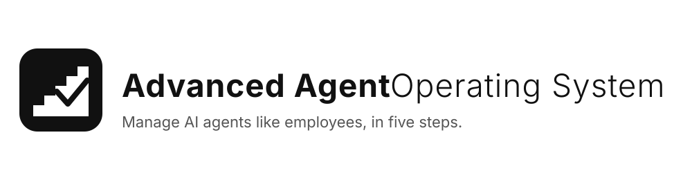
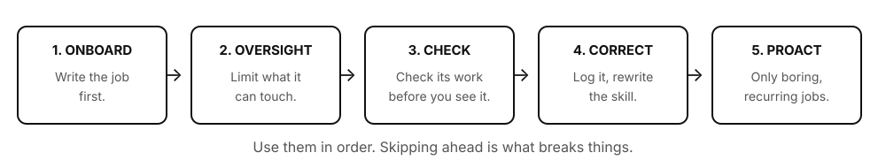

<div align="center">

<picture>
  <source media="(prefers-color-scheme: dark)" srcset="assets/readme/hero-dark.svg">
  
</picture>

[Quick start](#quick-start) · [User guides](docs/user/) · [How it is built](docs/internals/) · [Contributing](CONTRIBUTING.md)

[](LICENSE)
[](https://github.com/Fallenotp/advanced-agent-operating-system/actions/workflows/checks.yml)

</div>

Picture this: you ask an agent to draft an email, and it sends the draft to almost 200,000 people. Nobody told it to send anything. It had the tool to send mail, so it sent the mail. That is the mistake this manual exists to stop.

You already hand work to an AI agent — Claude Code, Codex, Cursor, or whichever your harness is — on the machines you own. This manual shows you how to manage it the way you would manage an employee: give it a written job, limit what it can touch, check its work before you see it, learn from every correction, and only then let it act on its own.

<picture>
  <source media="(prefers-color-scheme: dark)" srcset="assets/readme/five-steps-dark.svg">
  
</picture>

## What it gives you

**A written job, before any building.** One page that says what the agent does, in what order, what good looks like, and what it must never do. If you cannot write it down, you cannot hand it off.

**Oversight that fits the stakes.** One agent, one job, only the tools it needs. A rule in a prompt is a suggestion; taking the tool away is a restriction. Low-risk work goes alone, public or money work asks first, irreversible work goes to you.

**A check before your first look.** The agent proves its work with real evidence — a test result, a screenshot, a recalculated total — and a different agent checks anything the public, a client, or money will touch. The video puts first drafts at roughly 70%; with checks, they get to 95–99%.

**A system that learns.** Every correction is logged once, with context. The second time the same thing goes wrong, the skill itself is rewritten, with your approval. The agent does not retrain; its written instructions improve.

**Proactivity, last and only for boring jobs.** Level 4 proposes, Level 5 fixes and tells you after. Only boring, recurring problems — stale data, clashing notes, deadlines about to slip. Strategy stays with you.

<details>
<summary>What this is not</summary>

- Not a co-founder agent. Strategic decisions stay with a human expert.
- Not fully automatic learning. The owner approves every correction before it becomes permanent.
- Not a prompt pack. A prompt is not a permission layer — access and checks are.

</details>

## Quick start

Three steps. The clone and the gate take about two minutes; filling in the template is the real work.

1. Clone the manual:

   ```sh
   git clone https://github.com/Fallenotp/advanced-agent-operating-system.git
   cd advanced-agent-operating-system
   ```

2. Run the gate on the repo itself, to see the checks pass:

   ```sh
   bash checks/gate.sh --target=.
   ```

3. Copy the job-description template and fill it in for your first agent:

   ```sh
   cp templates/job-description-template.md my-first-agent.md
   ```

Then work the steps in order: [write the job](docs/user/step-1-onboard-like-a-new-hire.md), [limit the tools](docs/user/step-2-match-oversight-to-stakes.md), [check the work](docs/user/step-3-never-take-first-look.md), [log the corrections](docs/user/step-4-every-correction-becomes-the-system.md), and only then [let it act alone](docs/user/step-5-proactive-not-reactive.md).

## Documentation

| To | Read |
|---|---|
| Onboard your first agent | [docs/user/step-1-onboard-like-a-new-hire.md](docs/user/step-1-onboard-like-a-new-hire.md) |
| Decide what it may touch | [docs/user/step-2-match-oversight-to-stakes.md](docs/user/step-2-match-oversight-to-stakes.md) |
| Check its work before you see it | [docs/user/step-3-never-take-first-look.md](docs/user/step-3-never-take-first-look.md) |
| Log a correction | [docs/user/step-4-every-correction-becomes-the-system.md](docs/user/step-4-every-correction-becomes-the-system.md) |
| Let it act on its own | [docs/user/step-5-proactive-not-reactive.md](docs/user/step-5-proactive-not-reactive.md) |
| Copy a template | [templates/](templates/) |
| How the gate checkers work | [docs/internals/gate-checkers.md](docs/internals/gate-checkers.md) |
| The lint checks, and what we got wrong building them | [docs/internals/lint-checks-that-hold.md](docs/internals/lint-checks-that-hold.md) |
| Set up the repo protections | [docs/operations/setup-checklist.md](docs/operations/setup-checklist.md) |
| The skills themselves | [skills/](skills/) |
| The gate scripts | [checks/](checks/) |

## Development

There is nothing to build — this repo is a written manual plus small check scripts. What you can run:

```sh
python3 checks/tests/run_corpus.py   # every checker against good and cheating inputs
bash checks/gate.sh --self-test     # the corpus plus the gate's own scenarios
bash checks/gate.sh --target=.      # the gate on this repo (docs-only, passes with a note)
```

See [docs/operations/merging.md](docs/operations/merging.md) for how changes land, and [CONTRIBUTING.md](CONTRIBUTING.md) before opening a pull request. Agent contributors start at [AGENTS.md](AGENTS.md): the gate scripts are the enforcement, and they live in `checks/`.

## Lineage

This manual was written in November 2026 from a video walkthrough of the five steps, researched and built by one person working alone. It is not a fork. The walkthrough is linked in [Sources](docs/README.md#sources).

| | This manual | A prompt pack | Agent-side hooks | A "co-founder" agent |
|---|---|---|---|---|
| What it changes | The agent's written job and its access | The words you send | The harness, mid-action | Nothing — it advises |
| Enforcement | Lint checks in CI, blocking the merge | None — a prompt is a suggestion | Per-harness, not portable | None |
| Learns from corrections | Yes — Step 4 rewrites the skill | No | No | No |
| Works across harnesses | Yes — skills and scripts are plain files | Mostly | No | Depends on the product |

Compared from what is public about these approaches as of November 2026.

## License

Creative Commons Attribution 4.0 International (CC BY 4.0). See [LICENSE](LICENSE).
